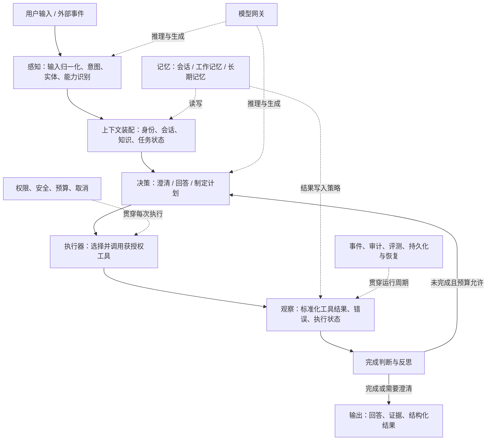
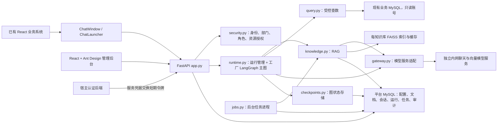
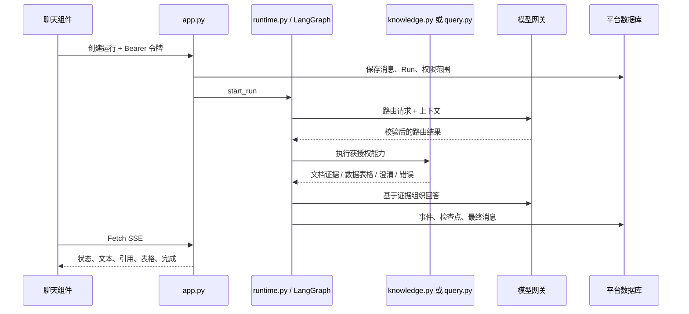

> 模块化更新（2026-11-04）：源码现已按能力目录管理。当前结构、模块 README 与旧路径映射见 [模块化目录导航](module-map.md)。本文中的旧路径属于对应阶段的历史说明，不是现行目录清单。

> 版本提示（2026-11-04）：下文保留 0.1.0 初次交付基线。源码已按职责重构，当前目录与七项原则说明见 [面向对象设计与源码学习指南](design-principles.md)；不要按本文旧路径判断新代码仍集中在 app.py/runtime.py。

# 项目交付说明书：目录、Agent 架构与实现边界

版本：0.1.0；核对日期：2026-11-01。本文以当前源代码为准，供接手开发、架构评审和部署交付使用。

## 1. 交付结论

当前交付是 **工厂内网问答应用、LangGraph 受控工作流和部分可复用基础接口**。它具备 RAG、受控查数、身份权限、会话、运行记录与恢复能力，但**还不是一个具备通用自主规划、动态工具执行、反思循环和长期记忆的完整 Agent 框架**。

原有说明中“通用 Agent 底座”描述的是建设目标，不能理解为所有模块均已实现。目录也尚未充分体现该目标：感知、上下文、流程决策、回答与运行生命周期集中在 `backend/services/runtime.py`，HTTP 接口集中在 `backend/app.py`。本文分别给出实际架构与后续目标，不将二者混用。

本次交付说明不调整运行代码，不移除 LangGraph，不表示已经完成架构重构。

## 2. 完整 Agent 应有的架构，与当前实现的对应

Agent 的核心是“接收观察 → 理解任务 → 制定下一步 → 执行动作 → 观察结果 → 判断是否完成”的闭环。RAG、模型接口和图编排分别承担其中一部分，单独存在不能代表完整 Agent。



**这张图是概念参考架构，不是当前代码已经完整实现的调用图。** 当前状态如下：

| 模块 | 当前状态 | 代码位置 | 实际能力与边界 |
|---|---|---|---|
| 输入与输出 | 已实现应用能力 | `backend/app.py`、`packages/chat/src/` | HTTP 输入、SSE、引用、表格；没有统一外部事件总线 |
| 感知 | 部分实现 | `runtime.py` 的 `route()`、`core/contracts.py` 的 `Route` | 结合历史与主题选择 knowledge/data/mixed/clarify；未抽象成通用感知服务 |
| 上下文装配 | 部分实现 | `runtime.py` 的 `history_for()`、`route()` | 当前授权历史、最近消息与长度触发摘要；没有独立上下文管理器或精确 token 预算管理 |
| 任务规划 | 领域内实现 | `runtime.py`、`services/query.py` | 固定路由、混合任务依赖判断、结构化查询计划；没有通用多步 Planner |
| 决策与自主循环 | 未实现通用能力 | 当前无独立实现 | 主图按固定路径执行；不会反复选择任意工具、观察结果后自主重规划 |
| 工具定义与注册 | 基础实现，未集成主流程 | `core/contracts.py` 的 `Tool`、`ToolRegistry` | 参数校验、角色限制、超时、注册；工厂流程直接调用服务，没有经注册表统一调度 |
| 工具执行器 | 未实现通用能力 | 工厂能力由服务直接执行 | 没有模型工具调用协议解析、统一工具观察结果、幂等机制和审批执行器 |
| 知识检索 / RAG | 已实现首期应用能力 | `services/knowledge.py` | 文档入库、授权检索、向量与关键词融合、版本校验及引用 |
| 数据查询 | 已实现首期领域能力 | `services/query.py`、`schemas.py` | 闭合查询计划编译、字段白名单、部门条件、只读事务；非任意 SQL Agent |
| 短期记忆 | 部分实现 | `models.py` 的 Conversation/Message、`runtime.py` | 会话历史与摘要；图状态承担一次运行的工作状态 |
| 长期记忆 | 仅协议 | `core/contracts.py` 的 `MemoryStore` | 没有 get/put 的持久化实现，也没有自动提取、检索、遗忘和写入策略 |
| 模型网关 | 已实现首期适配 | `infra/gateway.py` | 文本、结构化结果、流式回答、向量及模拟器；未实现通用原生 tool-call 循环 |
| Agent 定义 | 部分实现 | `Record(kind='agents')`、引导配置与后台 | 选择模型、提示词、知识库、主题和执行预算；没有独立 AgentDefinition 类型与执行策略插件 |
| 执行生命周期 | 已实现应用能力 | `runtime.py`、Run/RunEvent | 启动、事件、取消、预算、完成和失败；依赖当前工厂图 |
| 安全策略 | 应用实现 + 预留协议 | `infra/security.py`、`ExecutionPolicy` | 实际授权通过函数执行；ExecutionPolicy 还没有被注入运行时 |
| 检查点与恢复 | 已实现 LangGraph 适配 | `infra/checkpoints.py` | SQL 存储图状态、父检查点与 pending writes；当前不支持换成轻量引擎即无缝运行 |
| 反思 / 自校验 | 有限领域检查 | 查询计划校验、引用复核 | 没有独立 Critic，也没有自动迭代改进与完成判断循环 |
| 评测与反馈 | 基础实现 | `services/evaluation.py`、审计与测试 | 路由、引用/表格存在性及用户评分；不是完整的答案正确性或事实性评测平台 |
| 多 Agent / 调度 / 人工审批 | 未实现 | 尚无对应执行模块 | 属于未来扩展方向；不能把它们说成已有可运行的插件系统 |

## 3. 当前实际系统架构



API 与 worker 是两个进程，共享平台数据库和文档目录。FAISS 是应用内库，不是独立数据库服务。平台 MySQL 与业务 MySQL 可以位于同一现有服务器，但应使用独立数据库和不同权限账号。

**核心与业务目前的真实依赖：** `core` 不依赖 Web 或 ORM；`infra` 提供技术实现；`services/runtime.py` 同时依赖 LangGraph、SQLAlchemy、FastAPI 的 HTTPException、基础设施和工厂服务。因此目前尚未达到“业务运行时与框架完全解耦”。

## 4. 文件夹与文件交付清单

以下列出需要阅读或维护的源文件；忽略依赖目录、字节码和临时输出。

```text
my-base-agent/
├── README.md                         启动入口、命令与文档导航
├── pyproject.toml / uv.lock           Python 依赖、锁定版本、测试与代码检查
├── package.json / package-lock.json   Node 工作区与依赖锁
├── .env.example                      开发环境配置模板
├── alembic.ini                       数据库迁移配置
├── backend/
│   ├── __init__.py                   默认关闭外部追踪的环境设置
│   ├── config.py                     配置读取与生产配置校验
│   ├── bootstrap.py                  显式引导与开发合成数据导入
│   ├── app.py                        当前所有 HTTP 接口、配置校验、SSE 与鉴权依赖
│   ├── core/
│   │   └── contracts.py              身份、执行上下文、协议、工具注册表和路由结果
│   ├── infra/
│   │   ├── db.py                     SQLAlchemy 引擎、会话和声明基类
│   │   ├── models.py                 平台持久化实体
│   │   ├── security.py               令牌、凭据加密、资源授权与审计函数
│   │   ├── gateway.py                模型 API 适配器及确定性模拟器
│   │   └── checkpoints.py            LangGraph SQL 检查点适配器
│   └── services/
│       ├── runtime.py                工厂图、子图、上下文、事件和运行生命周期
│       ├── knowledge.py              解析、切分、向量化、索引、检索及证据复核
│       ├── query.py                  查询计划生成、SQL 编译与只读执行
│       ├── schemas.py                查询计划、业务主题、请求配置等 Pydantic 模型
│       ├── jobs.py                   任务领取、租约续期、有限重试与后台循环
│       └── evaluation.py             首期工作流评测执行器
├── packages/chat/
│   ├── src/index.tsx                 ChatWindow 与 ChatLauncher
│   ├── src/client.ts                 Bearer 请求、Fetch SSE、断线续读
│   ├── src/style.css                 独立前缀样式
│   └── package.json / vite.config.ts / tsconfig.json
├── web/
│   ├── src/main.tsx                  管理后台、配置表单、调试聊天与示例宿主页面
│   ├── src/style.css                 管理后台布局与样式
│   ├── index.html                    页面入口
│   └── package.json / vite.config.ts / tsconfig.json
├── migrations/
│   ├── env.py                        迁移环境
│   └── versions/001_initial.py        初始平台表与 MySQL ngram 全文索引
├── examples/
│   ├── host_server.py                仅开发使用的宿主身份交换示例
│   └── tool_agent.py                 直接调用注册工具的示例，不含自主 Agent 循环
├── tests/
│   ├── conftest.py                   隔离测试数据和客户端
│   ├── test_api_runtime.py           API、权限、工作流、恢复、取消与评测
│   ├── test_security_query.py        查询白名单、参数绑定及部门范围
│   ├── test_knowledge_jobs.py        RAG、文档替换、租约与任务失败
│   ├── test_gateway_and_formats.py   模型协议、格式解析及生产配置
│   └── browser/workbench.spec.ts     管理后台、嵌入与窄屏交互
├── scripts/
│   ├── benchmark.py                  隔离的合成检索容量测试
│   ├── mysql_smoke.py                独立测试库中的 MySQL 实测
│   ├── e2e_server.py                 浏览器测试专用服务
│   ├── backup.py                     MySQL 与原始资料备份恢复
│   └── build-offline.sh              x86_64 镜像、离线包和校验清单
├── deploy/
│   ├── Dockerfile.api / Dockerfile.web
│   ├── requirements.lock             镜像内 Python 依赖版本与哈希
│   ├── nginx.conf                    静态资源与无缓冲 SSE 代理
│   ├── mysql-bootstrap.sql           DBA 账号与授权示例
│   └── production.env.example        生产配置模板
├── compose.yaml                      API、worker、web 的生产服务定义
├── compose.mysql-test.yaml           独立的 MySQL 8.0.31 测试容器
├── playwright.config.ts              隔离端口、测试服务和浏览器配置
├── docs/                             设计、集成、部署、验收与本说明书
└── artifacts/
    ├── factory-agent-chat-0.1.0.tgz   可安装的 React 组件包
    └── offline-bundle/               镜像、模板、组件、文档与 SHA256SUMS
```

运行后生成的 `data/documents` 是原始资料，`data/indexes` 是可重建索引。SQLite 开发库也在 data 下；生产配置把平台数据写入 MySQL。`node_modules`、`.venv`、`__pycache__`、`dist` 和 `test-results` 不属于架构模块。

## 5. 一次问答到底怎样执行

### 5.1 在线请求

1. 宿主后端依据已登录会话交换令牌；平台按身份映射读取用户、角色、部门。
2. 聊天组件创建会话并发送问题；`app.py:create_run()` 保存用户消息与 Run，检查同会话是否已有运行。
3. `runtime.py:start_run()` 启动进程内异步任务，`execute_run()` 读取 Agent 配置与权限范围。
4. `build_graph()` 构造工厂图。`route()` 将可用主题、当前问题与授权历史交给模型，校验结构化路由结果。
5. 知识问题执行检索与证据复核；数据问题执行计划生成、编译、部门过滤和只读查询；混合问题按依赖串行或并行执行。
6. `answer()` 再检查权限与证据，生成回答，并写入 delta、citations、table 等事件。
7. 最终答案保存为助手消息，Run 标记 done；异常、取消或超时进入相应终态。
8. `app.py:stream_events()` 从事件表读取 SSE，聊天组件展示结果；断线按事件 ID 续读。



### 5.2 文档入库

上传 → 保存原始文件与 queued 文档 → 写入 Job → worker 领取租约 → 解析与切分 → 内网向量化 → 事务切换活跃文档版本 → 生成 FAISS 索引世代与清单 → 完成任务。导入过程中旧版本继续可读；失效索引可以回退到数据库向量构建。

### 5.3 当前的决策边界

“知识检索”和“数据查询”是两个受控能力流程，不是两个独立自主 Agent。查询计划只选择预配置维度、指标、筛选和关联；不会动态探索全库。当前没有“工具调用失败后自动重新规划并反复尝试”的通用闭环。

## 6. 数据与配置归属

| 存储 | 内容 | 是否可当作 Agent 记忆 |
|---|---|---|
| records | 模型、Agent、知识库、数据源、主题、用户、角色、部门、身份映射、评测配置 | 是配置，不是长期记忆 |
| conversations / messages | 会话归属、用户和助手消息、摘要与来源载荷 | 短期会话记忆 |
| runs / run_events | 单次执行状态、输入输出及事件 | 运行记录，不等于可检索长期记忆 |
| graph_checkpoints / graph_writes | 图状态与待提交写入 | 执行恢复状态，不等于语义记忆 |
| documents / chunks | 原始文档元信息、知识片段、向量和版本 | 外部知识库 |
| jobs | 导入及索引任务、租约、尝试次数 | 后台作业状态 |
| audits | 管理操作、查询、反馈与运行审计 | 治理记录 |
| 原始文件目录 / FAISS | 资料文件、派生检索缓存 | 文件与索引，不是独立记忆服务 |

把“有消息表、检查点或向量库”直接称为“完整记忆系统”是不准确的。长期记忆还需要定义写什么、谁能读、如何检索、何时过期、如何撤销以及是否允许从对话自动提取。

## 7. LangGraph 在哪里，是否可替换

`services/runtime.py` 使用 StateGraph 构建主图和两个子图；`infra/checkpoints.py` 实现对应存储。LangGraph 负责状态推进与检查点，不负责数据库权限、SQL 安全、检索算法或业务正确性。

当前并没有已实现的通用 `AgentRuntime` 协议和第二种执行器，因此“可替换”目前是重构方向，而不是切换配置即可实现的能力。若要移除 LangGraph，至少要抽取运行接口、事件协议、状态与恢复语义，并为轻量执行器补齐同样的测试。

建议先把工厂业务从图构建代码抽离，再决定是否保留 LangGraph，避免边拆框架边改变业务行为。

## 8. 后续目标目录：真正把 Agent 架构体现在代码里

**以下目录尚未创建，是建议的重构目标，不属于本次已实现清单。** 不建议只创建空目录来制造完整架构的观感。

```text
backend/
├── agent/                         通用 Agent 内核，不依赖工厂应用
│   ├── definitions.py            AgentDefinition、能力清单与执行策略
│   ├── perception/               输入理解、意图、实体与能力匹配
│   ├── context/                  上下文装配、消息裁剪、摘要和预算
│   ├── planning/                 Plan、Step、依赖关系和规划策略
│   ├── decision/                 下一步选择、完成判断与重规划规则
│   ├── execution/                Runtime 协议、生命周期、动作执行与观察
│   ├── tools/                    工具定义、注册、授权、结果及超时
│   ├── memory/                   会话、工作与长期记忆协议和写入策略
│   ├── models/                   与具体模型厂商无关的推理协议
│   ├── policies/                 权限、执行预算、人工审批与幂等约束
│   └── events/                   状态、文本、动作、观察和终态事件协议
├── adapters/                     框架与基础设施实现
│   ├── runtimes/                 lightweight 与可选 langgraph 实现
│   ├── persistence/              MySQL 存储、任务与检查点
│   ├── model_providers/          内网协议适配器与模拟器
│   └── retrieval/                FAISS、全文检索与索引管理
├── capabilities/                 可复用能力，不包含工厂路由
│   ├── rag/                      文档入库、检索与来源结果
│   └── structured_query/         查询计划、编译和受控执行
├── applications/
│   └── factory_assistant/        工厂 Agent 定义、业务路由、口径与展示结果
├── api/                          路由、鉴权依赖、请求响应与 SSE 映射
└── bootstrap/                    依赖组装、配置与启动
```

### 推荐实施次序与完成条件

1. **职责拆分**：将 app.py 拆成认证、管理、会话运行、文档路由；将 runtime.py 中感知、上下文、工厂流程和生命周期分别抽出。保持现有 API、SSE 与安全行为兼容。
2. **统一执行协议**：引入 AgentDefinition、AgentRuntime、Action、Observation 和终态结果；将知识和查数包装为获授权工具，主执行器不再直接依赖工厂服务。
3. **轻量运行时**：提供固定工作流执行器，LangGraph 通过适配器可选使用；明确两者是否都承诺步骤恢复，而不是默认二者恢复能力相同。
4. **自主闭环**：对确实需要的 Agent 增加规划、动作、观察、完成判断；限制步数、总时间、工具权限和重规划次数。工厂只读问答可继续固定流程。
5. **记忆与治理**：在独立用户授权和保留策略明确后实现长期记忆；再增加审批、写工具幂等、调度和多 Agent。不能直接把只读工具恢复机制套到写操作上。

至少以“新建一个非工厂 Agent，无需修改工厂服务和 API 主体；同一受控能力可以由不同运行时执行；权限、取消、事件和预算保持一致”作为底座完成验收条件。当前的加法示例只能证明工具接口可复用，不能证明上述目标已达成。

## 9. 交接与验收入口

| 接手角色 | 优先阅读 | 核对事项 |
|---|---|---|
| 架构与后端 | 本说明书 → contracts.py → runtime.py → query.py | 通用与业务边界、工具未集成处、权限与恢复语义 |
| 知识工程 | knowledge.py → jobs.py → architecture.md | 版本切换、向量模型一致性、授权检索、缓存与导入容量 |
| 前端 / 宿主集成 | docs/integration.md → packages/chat → web | 令牌交换、identityKey、单份 React、SSE 与样式 |
| DBA / 运维 | docs/deployment.md → compose.yaml → deploy | 平台库与只读业务账号、资源、密钥、备份和回滚 |
| 测试与验收 | docs/validation.md → tests → scripts | 自动测试与实际模型/目标硬件验收的区别 |

现有验证记录：32 项 Python 测试、3 项浏览器测试、MySQL 8.0.31 实测、前端构建、Linux x86_64 镜像及容器健康检查；详细范围见 validation.md。它们验证的是当前受控问答应用，不代表尚未实现的自主 Agent 内核已经验收。

本说明书交付后，当前代码的准确名称应是：**面向工厂问答的 Agent 基础能力原型与受控工作流应用**。若项目验收要求是“完整通用 Agent 底座”，第 8 节仍是需要实施的工作，而不是单靠补文档就能完成的交付。
