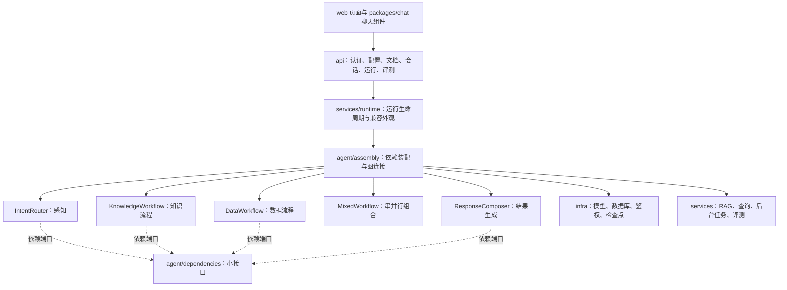

> 模块化更新（2026-11-04）：源码现已按能力目录管理。当前结构、模块 README 与旧路径映射见 [模块化目录导航](module-map.md)。本文中的旧路径属于对应阶段的历史说明，不是现行目录清单。

# 面向对象设计与源码学习指南

本轮重构日期：2026-11-04。目标是让职责和依赖可以从目录中读出来，保持现有 API、权限和问答行为兼容。原则是约束设计的工具，不是要求每个函数套一个类，也不是越多模式越好。

## 1. 先认识三个层次



`app.py` 只安装中间件、生命周期和路由；业务节点不从 app 导入对象，避免循环依赖。`assembly.py` 是组合根，允许认识具体类，负责把它们转换为节点所需的协议。生命周期仍保留在 services/runtime.py，兼容现有恢复和 API 调用。

## 2. 七项原则逐项对照

| 原则 | 本项目的实际应用 | 如何验证 / 避免误解 |
|---|---|---|
| 单一职责 SRP | HTTP 路由分领域；感知、知识、数据、混合、响应各有对象；前端拆页面与编辑器 | 修改路由提示词无需修改 SQL 编译器；不要把“单一职责”理解为每类只能有一个方法 |
| 开闭 OCP | 图装配通过策略表注册处理对象；模型和事件通过协议访问 | 添加新处理器可复用执行接口；增加新路由名称仍需同步路由输出约束，不宣称完全零修改 |
| 里氏替换 LSP | 模拟/真实模型遵循 ModelGateway；策略保持同样的结果键、异常与异步语义 | 授权异常不能被替代实现吞掉；测试用协作者验证串行顺序、并发和缺失口径行为 |
| 接口隔离 ISP | PerceptionPorts、KnowledgePorts、DataPorts、ResponsePorts 分开声明能力 | 装配容器可以完整，但每个节点标注自己需要的小接口；不要让检索器实现数据库管理方法 |
| 依赖倒置 DIP | 节点依赖模型/事件协议与注入回调，具体 SQL、HTTP、FAISS 集中由组合根注入 | 业务节点不再构造 Gateway 或 SQL 会话；组合根依赖具体实现是正常的系统边界 |
| 迪米特法则 LoD | 节点调用 history、retrieve、query、authorize_topic，不逐层访问连接、密钥或 ORM | 身份与配置是显式上下文值，不把 d.context.principal 的读取误解为任意跨层业务调用 |
| 合成复用 CRP | MixedWorkflow 组合两个能力策略；ChatLauncher 组合 ChatWindow | 不让数据流程继承知识流程；不创建含所有业务方法的 BaseAgent 父类 |

## 3. 实际采用的模式

### 策略模式

`agent/perception.py`、`knowledge.py`、`data.py`、`response.py` 是不同职责的策略对象，图节点绑定它们的异步方法。相同调用形式接收状态、返回状态补丁。`composition.py` 通过注入两个异步可调用对象，决定串行或并行组合。

```python
# 组合能力，而不是建立 KnowledgeAgent -> DataAgent 的继承关系。
workflow = MixedWorkflow(knowledge.knowledge, data.data)
result = await workflow.mixed(state)
```

策略结果必须保留 evidence、tables、errors、clarification 的约定，尤其是权限异常必须传播。参见 `tests/test_agent_strategies.py`。

### 适配器模式

`infra/gateway.py` 适配内网模型 HTTP；`infra/checkpoints.py` 适配 LangGraph 检查点；`packages/chat/src/client.ts` 适配浏览器 Fetch/SSE。它们隔离协议差异，不负责决定业务权限。

### 外观模式

`services/runtime.py:build_graph()` 是兼容外观，委托组合根组装新对象。原 API、评测与恢复代码可以逐步迁移。`KnowledgeRetriever` 为上层隐藏数据库、FAISS 和全文检索的组合细节。外观不是把复杂实现永久塞进一个巨型文件。

### 工厂方法与依赖注入

`agent/assembly.py:assemble_graph()` 和 `agent_gateway()` 集中选择、构造依赖。节点不调用全局服务定位器。注入依赖可以是函数或对象，不必为每一个三行函数再创建抽象工厂。

### 注册表与值对象

`core/contracts.py:ToolRegistry` 保持名称到受控工具的映射；Principal 是不可变身份值对象，ExecutionContext 保存单次执行预算。ToolRegistry 仍未成为工厂主流程的通用工具循环，不能把存在注册表等同于已实现自主 Agent。

## 4. 目录阅读顺序

1. `backend/core/contracts.py`：理解身份、上下文、模型/事件协议、工具边界。
2. `backend/agent/dependencies.py`：区分完整装配容器与每个节点的小接口。
3. `backend/agent/perception.py`：阅读上下文裁剪、路由输出与主题白名单校验。
4. `backend/agent/knowledge.py`、`data.py`：理解权限异常为什么不能降级为普通错误。
5. `backend/agent/composition.py`：观察组合复用与串并行策略。
6. `backend/agent/response.py`：阅读生成前、生成过程中及引用返回前的检查。
7. `backend/agent/assembly.py`：最后看对象如何被连接到 LangGraph。
8. `backend/services/runtime.py`：理解图之外的状态、持久化、恢复与取消。
9. `backend/api/`：了解领域逻辑如何映射为 HTTP、SSE 和认证依赖。
10. `web/src/components/`、`packages/chat/src/`：查看前端页面组合与宿主隔离。

## 5. 新旧目录映射

| 原位置 | 新职责位置 |
|---|---|
| app.py 中认证函数 | api/dependencies.py、authentication.py |
| app.py 中配置 CRUD | api/configuration.py |
| app.py 中文档/作业/审计接口 | api/documents.py |
| app.py 中会话和运行接口 | api/conversations.py、runs.py |
| app.py 中评测接口 | api/evaluations.py |
| runtime.py 中 route 闭包 | agent/perception.py 的 IntentRouter |
| runtime.py 中检索/查询闭包 | agent/knowledge.py、data.py |
| runtime.py 中 mixed/answer | agent/composition.py、response.py |
| runtime.py 中图连线 | agent/assembly.py |
| web/src/main.tsx 中所有页面 | web/src/components/，共享模板在 configuration.tsx |

## 6. 注释应该怎样读

模块注释说明边界；类注释说明对象拥有的职责；方法注释说明输入、结果、失败和安全语义；关键分支注释解释“为什么”。注释不逐行翻译赋值语句，不能代替有表达力的名称。

重点理解：

- 为什么先做授权再检索，且生成过程中仍检查撤权？因为请求执行期间权限可能变化。
- 为什么查询条件用绑定参数，但标识符还要白名单？绑定值不能保护动态表名和列名。
- 为什么中途流式响应不无限重试？已经发送的增量可能被重复拼接。
- 为什么会话历史、图检查点和长期记忆不是一回事？它们的隔离、恢复和保留目标不同。
- 为什么先保留兼容外观？行为迁移和架构迁移同时发生会增加定位回归的难度。

新增代码应沿用这些注释要求；测试注释说明所保护的契约，而不是只说“测试通过”。自动生成的依赖锁、构建产物和镜像二进制不是学习源码，不手改它们。

## 7. 本轮没有伪装成已完成的部分

这次是结构重构，没有新增自主规划/观察/反思循环、长期记忆实现、人工审批、多 Agent 协作或第二种执行引擎。LangGraph 仍是当前图执行器；核心协议没有完全吸收所有领域状态，知识/数据策略仍以工厂应用为背景。API 路由仍可直接使用 ORM；全面 Repository 层需要有实际替换需求才继续抽象。

尚存在的耦合与改进方向：知识/数据节点仍识别 FastAPI 的 HTTPException，这是保留旧异常行为的兼容措施；下一步可在安全边界引入领域异常，再由 API 映射为 HTTP，而不能仅删除异常处理。策略的状态载荷仍使用字典，后续可演进为领域结果类型。上述限制应公开记录，不能以七项原则的名称宣称完美架构。

## 8. 验证与交付版本

执行 Python 回归、新增策略契约测试、TypeScript 检查、前端构建和浏览器端到端检查。源码是本轮权威交付；既有 `artifacts/offline-bundle/images.tar` 是重构前的镜像，不应误认为自动包含新结构。需要部署本轮版本时重新执行离线打包脚本。
