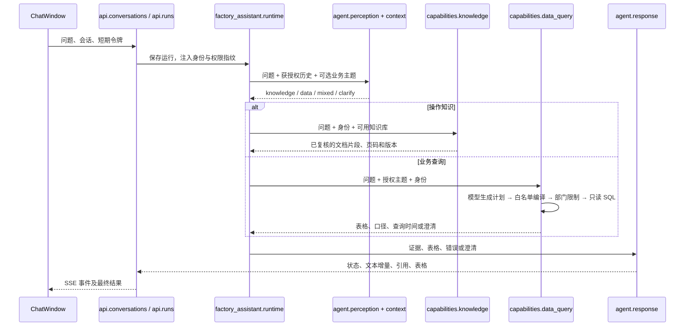

# 模块如何交互，以及怎样切换真实服务

## 一次真实执行的调用关系

混合查询没有依赖时并行执行 K/D；需要先确定知识口径时先 K 后 D，口径证据不足就澄清。每个节点进入与流式输出都受 ExecutionGuard 保护。模型生成文本不会改变授权范围。

## 如何在界面观察

每条助手消息上方有“查看模块执行过程”。它来自服务端持久化的 status 事件，而非前端编造动画；可看到路由选择、能力调用和生成前复核。阶段记录不会暴露模型内部推理、数据库密码或原始连接串。当前记录是阶段轨迹，还不是逐工具参数和耗时的完整调试器。

## 模拟与真实的边界

当前演示数据库有两个部门的合成记录；模拟模型使用规则和哈希向量。检索、数据库访问、权限、SSE 和检查点代码真实执行，但回答理解能力和业务内容仍是模拟的。这不能作为真实问答效果验收。

真实接入步骤：

1. 模型服务：将使用的模型 provider 配置为 openai-compatible，填写内网 /v1 地址、聊天及向量模型名称和密钥，运行接口测试。
2. 知识库：上传实际 PDF/DOCX/MD/TXT，检查导入任务；更换向量模型后必须重新导入原有资料，不能混用模拟向量。
3. 数据源：设置独立只读 MySQL 连接，授权审核过的表或视图；不能用平台写账号查询业务库。
4. 业务主题：配置真实表、允许字段、关联、指标口径及部门映射，启用后用人工 SQL 对照。
5. Agent 配置：只开放实际可用的知识库和业务主题；停用演示主题，避免真实和合成数据混合展示。

实际地址、模型名称、库表结构需要由现场提供。密码和 Key 应在本地配置或管理后台填写，不需要发到聊天中。
