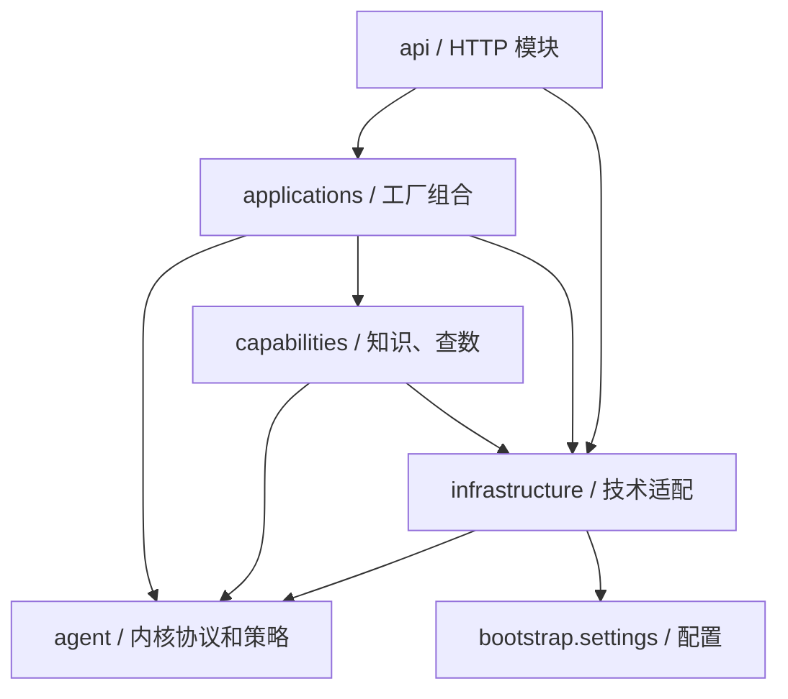

# 模块化目录与交付导航

更新：2026-11-04。本文件是当前源码目录的权威导航；初次交付说明中的旧目录保留为历史记录。

## 当前结构

```text
backend/
├── agent/                         通用内核：不依赖工厂应用、数据库或 API
│   ├── perception/                感知策略、端口、路由结果
│   ├── context/                   授权上下文与摘要装配
│   ├── execution/                 执行上下文、预算、取消、事件协议
│   ├── tools/                     工具定义与注册
│   ├── memory/                    长期记忆协议（尚无实现）
│   ├── models/                    模型能力协议
│   ├── response/                  回答组织、引用与输出事件
│   └── policies/                  身份、授权协议与执行守卫
├── capabilities/                  可复用领域能力
│   ├── knowledge/                 解析、导入、索引、检索、证据复核
│   └── data_query/                模式、查询编排、编译器、只读执行器
├── infrastructure/                具体技术实现
│   ├── models/                    内网模型适配与模拟器
│   ├── persistence/               数据库、实体、检查点、事件、历史
│   ├── identity/                  令牌、加密、资源授权、权限指纹
│   └── jobs/                      持久化任务租约与重试
├── applications/
│   └── factory_assistant/         工厂图、业务策略组合、领域状态与评测
├── api/                           HTTP 领域模块
│   ├── authentication/            登录、身份交换
│   ├── configuration/             模型、Agent、主题、用户等配置
│   ├── conversations/             会话与启动请求
│   ├── runs/                      状态、SSE、取消、反馈
│   ├── documents/                 文档、引用、导入任务及运维列表
│   ├── evaluations/               管理员评测入口
│   ├── dependencies.py            HTTP 身份依赖
│   └── schemas.py                 HTTP 请求模型
├── bootstrap/                     配置、显式初始化、CLI
└── app.py                         FastAPI 组合入口

web/src/
├── modules/
│   ├── workbench/                 登录和页面组合
│   ├── overview/                  工作台概览
│   ├── configuration/             列表、编辑器、表单模板
│   ├── knowledge/                 文档上传与状态
│   ├── operations/                任务与审计
│   └── host_demo/                 宿主接入演示
├── main.tsx                       主题与页面根入口
└── style.css                      管理后台公共样式

packages/chat/                     可独立安装的聊天组件模块
```

每个上述后端业务/能力/技术模块和前端模块都有自己的 README。小模块只放必要文件，不强制所有目录都包含 service/repository/factory 等空模板。

没有新建 `planning/`、多 Agent、人工审批或调度空目录。当前没有独立实现这些能力；工厂查询计划留在 `capabilities/data_query/schemas.py`，不能冒充通用自主规划器。

## 依赖方向



`agent` 内核不能导入 applications、infrastructure 或 API。能力模块允许使用实际存储和模型适配器，但不能选择工厂问答路由。组合根在 `applications/factory_assistant/assembly.py`，它可以认识具体实现。

当前是模块化单体：目录独立不代表每个模块必须独立容器部署。API 与后台 worker 仍是两个运行进程，复用同一平台数据库和文件目录。

## 各模块的公开入口

| 能力 | 推荐导入或入口 | 实现说明 |
|---|---|---|
| 身份 | `agent.policies.contracts.Principal` | 不可变身份值对象 |
| 执行上下文 | `agent.execution.context.ExecutionContext` | 预算、追踪、取消信号 |
| 守卫 | `agent.policies.guard.ExecutionGuard` | 外部状态由回调注入 |
| 上下文 | `agent.context.ContextBuilder` | 独立于存储的历史与摘要装配 |
| 感知 | `agent.perception.IntentRouter` | 接收 PerceptionPorts |
| 响应 | `agent.response.ResponseComposer` | 接收 ResponsePorts |
| 工具 | `agent.tools.registry.Tool / ToolRegistry` | 工厂主流程尚未统一走工具循环 |
| 模型端口 | `agent.models.contracts.ModelGateway` | 不绑定模型 HTTP 协议 |
| 长期记忆端口 | `agent.memory.contracts.MemoryStore` | 仅协议，未承诺实现 |
| 知识能力 | `capabilities.knowledge` | 明确重导出检索、导入、证据与索引入口 |
| 查询能力 | `capabilities.data_query` | compile_query、execute_readonly、query_data |
| 数据实体与会话 | `infrastructure.persistence.entities / database` | 不从旧 infra 导入新代码 |
| 后台工作者 | `python -m backend.infrastructure.jobs.worker` | 后台任务进程入口 |
| 初始化 | `python -m backend.bootstrap` | 命令保持不变，导入 settings 不执行 seed |
| API | `backend.app:app` | 外部 HTTP 路径和 SSE 类型保持不变 |

表中 Python 路径均以 `backend.` 为前缀。

## 目录边界与入口

旧 core、infra、services、config 及 agent 根级兼容转发已移除；所有调用方使用唯一实现路径。

- 能力逻辑（检索、查询编译）放 capabilities；技术适配（数据库连接、模型 HTTP 客户端）放 infrastructure。
- 当前能力层允许依赖基础设施，是模块化单体，不要求严格的端口适配隔离。
- app.py 是 HTTP 入口；applications/factory_assistant/assembly.py 组装具体依赖；runtime.py 管理运行生命周期；bootstrap 负责配置与初始化。

## 推荐阅读链路

1. 先看本文件与各模块 README。
2. 从 agent/policies/contracts.py 和 execution/context.py 理解身份与执行上下文。
3. 看 context/builder.py → perception/router.py，理解问题如何结合授权历史进入路由。
4. 看 applications/factory_assistant/composition.py，理解串行依赖与并行策略。
5. 看 capabilities/knowledge 和 data_query，理解真实能力如何执行。
6. 看 agent/response/composer.py 和 policies/guard.py，理解流式阶段的复核。
7. 最后看 applications/factory_assistant/assembly.py、runtime.py 以及 api 目录，理解装配、生命周期与对外协议。

## 验证与边界

`tests/test_module_boundaries.py` 验证：内核不反向依赖应用/基础设施、全仓源码不使用旧导入（包括动态导入与补丁目标），以及上下文模块可脱离数据库测试。现有问答、权限、图恢复、浏览器等回归测试继续保留。

本轮不改变数据库模式，不需要新增迁移。目录迁移没有新增自主规划、长期记忆实现或第二种图引擎。现有离线镜像为旧源码构建，部署本轮代码前需重新打包；镜像不会因为目录变化自动更新。
